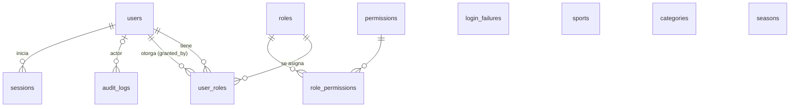

# Base de datos

PostgreSQL 17 + Prisma **7.10.0** (adaptador `@prisma/adapter-pg`). El esquema vive en `apps/api/prisma/schema.prisma` y **toda** modificación pasa por una migración versionada en `apps/api/prisma/migrations/`.

## Puesta en marcha desde cero

```bash
npm install
cp .env.example .env              # reemplazar cambiar-esta-clave por una contraseña propia
docker compose up -d db           # PostgreSQL en 127.0.0.1:${POSTGRES_PORT:-5432}
npm run db:deploy -w @liga/api    # aplica las migraciones
npm run db:seed -w @liga/api      # sincroniza permisos y el rol superadmin (idempotente)
npm run dev:api                   # GET http://localhost:3000/api/health/ready
```

> Si el puerto 5432 ya está en uso por otro servicio, defina `POSTGRES_PORT` (p. ej. 5434) y ajuste el puerto en `DATABASE_URL` y `TEST_DATABASE_URL`.

### Variables de entorno

| Variable            | Uso                                                                         |
| ------------------- | --------------------------------------------------------------------------- |
| `POSTGRES_USER`     | Usuario del contenedor de desarrollo.                                       |
| `POSTGRES_PASSWORD` | Contraseña del contenedor. **Obligatoria**, sin valor por defecto.          |
| `POSTGRES_DB`       | Base de datos de desarrollo.                                                |
| `POSTGRES_PORT`     | Puerto publicado en `127.0.0.1` (por defecto 5432).                         |
| `DATABASE_URL`      | Conexión de la API y de las migraciones. Validada al arrancar.              |
| `TEST_DATABASE_URL` | Conexión de las pruebas de integración. El nombre debe terminar en `_test`. |

`.env` está en `.gitignore`; solo se versiona `.env.example`, sin credenciales reales.

### Comandos (`@liga/api`)

| Comando                    | Acción                                                                                                          |
| -------------------------- | --------------------------------------------------------------------------------------------------------------- |
| `npm run db:generate`      | Genera el cliente en `src/generated/prisma` (no se versiona; se ejecuta antes de lint, tipos, pruebas y build). |
| `npm run db:migrate`       | **Desarrollo.** Crea y aplica una migración a partir de cambios en `schema.prisma`.                             |
| `npm run db:deploy`        | Aplica migraciones pendientes (producción, CI, bases nuevas).                                                   |
| `npm run db:status`        | Muestra el estado de las migraciones.                                                                           |
| `npm run db:seed`          | Compila y sincroniza permisos + rol `superadmin`. No crea datos institucionales.                                |
| `npm run test:integration` | Pruebas contra PostgreSQL real (base `*_test` aislada).                                                         |

### Cómo añadir o cambiar el esquema

1. Editar `schema.prisma`.
2. `npx prisma migrate dev --name <descripcion> --create-only` (dentro de `apps/api`).
3. Si se necesita una restricción `CHECK`, un trigger u otro objeto que Prisma no expresa, añadir ese SQL **en la misma migración** antes de aplicarla (ver `…_init/migration.sql`).
4. `npm run db:migrate` para aplicarla, y comprobar que no hay deriva: `npx prisma migrate diff --from-config-datasource --to-schema prisma/schema.prisma --exit-code`.
5. Añadir pruebas de integración.

Nunca se edita una migración ya aplicada en un entorno compartido ni se altera la base de datos a mano.

## Convenciones

| Tema                 | Convención                                                                                                                                                                                                                                      |
| -------------------- | ----------------------------------------------------------------------------------------------------------------------------------------------------------------------------------------------------------------------------------------------- |
| Identificadores      | `uuid` v7 generado por Prisma (`@default(uuid(7))`, tipo `uuid`). Son ordenables por tiempo. No hay default en la BD: un `INSERT` manual debe aportar el `id`.                                                                                  |
| Nombres              | Tablas y columnas en `snake_case` inglés (`@@map`/`@map`); modelos y campos en `camelCase`.                                                                                                                                                     |
| Instantes            | `timestamptz(3)` en UTC (`created_at`, `updated_at`, `last_login_at`…). La zona horaria local (`America/Guayaquil`, UTC‑5, sin horario de verano) se aplica **solo al mostrar**.                                                                |
| Fechas de calendario | `date` sin hora (inicio/fin de temporada). Se leen y escriben como fecha pura, sin desplazamientos de zona.                                                                                                                                     |
| Estados              | Enumeraciones de PostgreSQL con los valores en español definidos en `requirements.md` (`activo`, `borrador`…).                                                                                                                                  |
| Eliminación          | No se borra lo que tiene trazabilidad: se **desactiva por estado**. Las claves foráneas hacia usuarios, roles, y desde `audit_logs` son `ON DELETE RESTRICT`. `CASCADE` solo se usa en `role_permissions` (configuración sin historial propio). |
| Códigos              | `code` en minúsculas (`^[a-z][a-z0-9_]*$`), estable y usado por el código; `name` es el texto visible.                                                                                                                                          |

## Modelo actual



| Tabla               | Propósito y reglas                                                                                                                                                                                                                                                                                                                                                             |
| ------------------- | ------------------------------------------------------------------------------------------------------------------------------------------------------------------------------------------------------------------------------------------------------------------------------------------------------------------------------------------------------------------------------ |
| `users`             | Cuenta. `email` único y en minúsculas (CHECK). `status`: `pendiente`/`activo`/`inactivo`/`bloqueado`; `password_hash` es nulo solo mientras está pendiente (CHECK: activa ⇒ con contraseña, pendiente ⇒ sin ella). Sin `person_id` aún.                                                                                                                                        |
| `roles`             | `code` único. `is_system`: un trigger impide eliminar los roles de sistema incluso por SQL directo.                                                                                                                                                                                                                                                                            |
| `permissions`       | Catálogo `recurso:acción` definido por el código (`src/authz/permissions.ts`) y sincronizado con `db:seed`.                                                                                                                                                                                                                                                                    |
| `role_permissions`  | PK compuesta (`role_id`, `permission_id`).                                                                                                                                                                                                                                                                                                                                     |
| `user_roles`        | Un usuario puede tener varios roles. Clave propia + `UNIQUE(user_id, role_id)` para poder añadir luego un alcance (p. ej. club). `granted_by_id` registra quién otorgó.                                                                                                                                                                                                        |
| `credential_tokens` | Enlaces de un solo uso (activación / restablecimiento): solo el **SHA-256** del token, vencimiento, `used_at` / `revoked_at` (CHECK: no ambos), emisor (`ON DELETE RESTRICT`) y propietario (`CASCADE`).                                                                                                                                                                       |
| `sessions`          | Sesiones de servidor. Guarda el **SHA-256** del identificador de la cookie (nunca el valor), token CSRF, caducidad absoluta, última actividad, `User-Agent` truncado, hash de IP y revocación con motivo (CHECK: `revoked_at` y `revocation_reason` van juntos; formato de hash). `ON DELETE CASCADE` desde `users` (no son un registro de trazabilidad: eso es `audit_logs`). |
| `login_failures`    | Intentos de acceso fallidos recientes, por clave con hash (`ip`, `cuenta_ip`, `cuenta`), para la limitación de intentos. Se depuran periódicamente.                                                                                                                                                                                                                            |
| `audit_logs`        | Operación, actor (nulo para sistema/anónimo), entidad, snapshots antes/después, motivo, hash de IP y momento. **Inmutable**: un trigger rechaza `UPDATE` y `DELETE`. Índices por entidad, actor+fecha, acción y fecha.                                                                                                                                                         |
| `sports`            | `code` y `name` únicos, estado de catálogo. Sin reglas por deporte (van en reglamentos versionados).                                                                                                                                                                                                                                                                           |
| `categories`        | `code` y `name` únicos, `age_min`/`age_max` **opcionales** (CHECK: 0 ≤ min ≤ max ≤ 120), `sort_order`, estado. No pertenece a un deporte.                                                                                                                                                                                                                                      |
| `seasons`           | `name` único, `start_date`/`end_date` (CHECK `end_date > start_date`), estado `borrador`/`activa`/`finalizada`/`archivada`.                                                                                                                                                                                                                                                    |

> Los catálogos `sports`, `categories` y `seasons` se administran desde la API sin tablas nuevas; ver `catalogs.md`.

### Clubes, personas, deportistas y equipos

Detalle de reglas y endpoints en `clubs-people-teams.md`.

| Tabla                  | Propósito y reglas                                                                                                                                                                                                                        |
| ---------------------- | ----------------------------------------------------------------------------------------------------------------------------------------------------------------------------------------------------------------------------------------- |
| `clubs`                | `name_key` (nombre normalizado) y `slug` únicos; estado. Se elimina solo si nada lo referencia (FK `RESTRICT`).                                                                                                                           |
| `club_users`           | Alcance: vincula usuarios con los clubes que pueden gestionar (PK compuesta).                                                                                                                                                             |
| `club_representatives` | Representantes con vigencia; apuntan a una persona.                                                                                                                                                                                       |
| `persons`              | Identidad básica: nombres y fecha de nacimiento (`DATE`, CHECK ≥ 1900; la fecha futura se rechaza en el servicio porque `CURRENT_DATE` no es inmutable).                                                                                  |
| `person_private_data`  | Documento, teléfono y tutor, **separados** de la identidad. `id_key` (`tipo:número` normalizado) **único**.                                                                                                                               |
| `athletes`             | Una persona = un deportista (`person_id` único); club; `code_number` correlativo (DEP‑000123); habilitación; marca de perfil público.                                                                                                     |
| `consent_records`      | Consentimientos por persona y tipo; se revocan, no se borran. Índice único parcial: un solo consentimiento `otorgado` por persona y tipo.                                                                                                 |
| `teams`                | Club + deporte + nombre por defecto; único `(club, deporte, nombre normalizado)`.                                                                                                                                                         |
| `team_seasons`         | Inscripción de un equipo en una temporada con su categoría y **nombre de esa temporada**; `sport_id` repetido con clave compuesta hacia `teams`; único `(temporada, deporte, nombre normalizado)`.                                        |
| `team_memberships`     | Alta de un deportista en una plantilla. **Único `(athlete_id, sport_id, season_id)`** (un equipo por deporte y temporada); FK compuesta a `team_seasons`; CHECK de baja con fecha y motivo; dorsal único entre vigentes (índice parcial). |

### Qué no se modeló todavía, a propósito

- **Categorías por deporte, género, peso, modalidad:** la Liga no ha confirmado estas reglas (ver `decisions.md`). La relación deporte‑categoría se establecerá en el campeonato; peso y modalidad serán conceptos propios, nunca columnas de `categories`.
- **Reglas de puntuación y desempate:** irán en reglamentos versionados (`competition_rule_versions`) junto a los campeonatos.
- **Superposición de temporadas / una sola activa:** no está especificado; no se restringe.

## Decisión: modelo de participantes (ADR‑001)

**Estado:** aceptada. **Implementación:** diferida hasta que existan `teams`, `athletes` y `championships`; sus migraciones se crean con esos módulos.

### Contexto

`requirements.md` §8.2 exige elegir antes de crear migraciones de inscripciones. Hay que cubrir fútbol y básquet (equipos con plantilla), ajedrez (individual, rondas y emparejamientos), taekwondo (individual por edad, peso y modalidad, a confirmar) y mantener integridad referencial en inscripciones, eventos y resultados. No todas las disciplinas comparten ciclo de competición.

### Opciones

|                                      | A. Entidad común `participants`                                                                                 | B. Tablas separadas (`team_registrations`, `individual_registrations`)                                               |
| ------------------------------------ | --------------------------------------------------------------------------------------------------------------- | -------------------------------------------------------------------------------------------------------------------- |
| Eventos y resultados                 | `event_participants` apunta a una sola FK (`registration_id`). Marcadores, tablas y llaves se escriben una vez. | Cada evento necesita dos FK opcionales + CHECK «exactamente una», o duplicar `event_participants` y `result_values`. |
| Clasificaciones                      | Una consulta uniforme para equipos e individuos.                                                                | Consultas duplicadas o `UNION` en cada cálculo.                                                                      |
| Integridad                           | FK reales. La coherencia subtipo/tipo se garantiza con FK compuesta (`participants(id, kind)`).                 | FK reales y simples, pero la lógica común se repite.                                                                 |
| Nuevas disciplinas o formatos        | Un deporte con parejas o equipos mixtos solo añade un subtipo.                                                  | Cada nuevo tipo crea otra familia de tablas.                                                                         |
| Riesgo                               | Que `participants` se convierta en «entidad comodín» con campos de cada deporte.                                | Divergencia entre las dos ramas con el tiempo.                                                                       |
| Una relación polimórfica `(type,id)` | Descartada por la especificación: sin claves foráneas reales.                                                   |                                                                                                                      |

### Decisión

**Opción A**, limitada a identidad y tipo; todo lo específico se cuelga de la inscripción o del evento:

```text
participants            (id, kind: equipo | individual)
  UNIQUE (id, kind)
team_participants       (participant_id PK, kind = 'equipo' CHECK, team_id UNIQUE → teams)
                         FK (participant_id, kind) → participants (id, kind)
individual_participants (participant_id PK, kind = 'individual' CHECK, athlete_id UNIQUE → athletes)
                         FK (participant_id, kind) → participants (id, kind)
registrations           (id, championship_id, participant_id, status, … )
  UNIQUE (championship_id, participant_id)
```

- El equipo es una identidad organizativa reutilizable entre temporadas (recomendación de §8.1); la plantilla (`team_memberships`) es por temporada y **no** es parte del participante.
- Fútbol y básquet usan `kind = equipo`; ajedrez y taekwondo, `kind = individual`. Un formato que lo requiera (p. ej. equipos de taekwondo) usa `equipo` sin cambiar el núcleo.
- Extensiones específicas (no implementadas): `football_events`, `event_period_scores` (básquet), `chess_pairings`, y para taekwondo un detalle de inscripción con división de peso/modalidad (`taekwondo_registration_details`) y `taekwondo_bouts`. Todas referencian `registrations` o `events`, nunca `participants`.
- Las clasificaciones por club (p. ej. medallero) se **calculan** agregando por el club del deportista/equipo; el club no es un participante.

### Pendiente de la Liga (bloquea la implementación, no la decisión)

- ¿Un equipo puede competir con nombre distinto entre temporadas? ¿Un deportista puede estar en más de un equipo?
- Modalidades reales de taekwondo y si hay eventos por equipos.
- ¿Ajedrez por equipos/clubes, o solo individual?

## Pruebas de integración

- Se ejecutan contra una base **aislada** `*_test` (`TEST_DATABASE_URL`). El arranque se niega a continuar si el nombre no termina en `_test`, y los workers sustituyen `DATABASE_URL` por la URL de pruebas, de modo que ningún código bajo prueba puede alcanzar la base de desarrollo.
- `globalSetup` crea la base si no existe y ejecuta `prisma migrate deploy`: funciona sobre un servidor nuevo, es repetible y es el mismo procedimiento que usa CI (servicio PostgreSQL efímero en `.github/workflows/ci.yml`).
- Antes de cada prueba se vacían las tablas con `TRUNCATE … CASCADE` tras comprobar `current_database()`. `audit_logs` es inmutable ante `UPDATE`/`DELETE`, pero `TRUNCATE` se permite para ese reinicio.
- Cubren: conexión, migraciones aplicadas, creación/consulta, relaciones usuario‑rol‑permiso, unicidad, integridad referencial y `RESTRICT`, CHECK, auditoría inmutable, catálogos y seed.

## Limitaciones conocidas

- **Inmutabilidad de `audit_logs`:** el trigger frena `UPDATE`/`DELETE` de la aplicación y de SQL ordinario, pero no a quien sea propietario de la tabla o superusuario (puede deshabilitar triggers o ejecutar `TRUNCATE`). En producción debe usarse un rol de aplicación distinto del propietario de las migraciones, sin `TRUNCATE`, `ALTER` ni `TRIGGER` sobre esa tabla. Queda como tarea del despliegue (`docs/deployment.md`, pendiente).
- **Primer superadministrador:** `db:seed` crea el rol `superadmin` pero ninguna cuenta. El alta se hace con `npm run admin:create-superadmin -w @liga/api` (ver `authentication.md`).

## Cuentas pendientes y tokens de credencial

Migraciones `users_admin_enums` (valor `pendiente` y `contrasena_cambiada`, `password_hash` anulable) y `credential_tokens` (tabla, enum `credential_token_kind` y CHECK de integridad cuenta‑contraseña). PostgreSQL no permite usar un valor de enum recién añadido en la misma transacción, por eso son dos migraciones. Ver `administration.md`.
